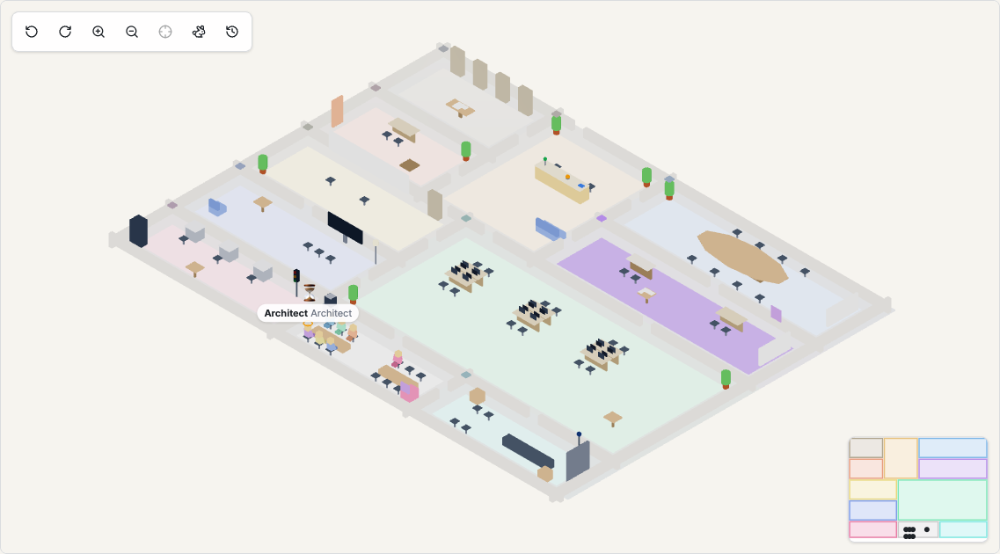

# The 3D office

The **Office 3D** tab of a project shows the team at work in an isometric office. It is a view
of the same live state as the 2D dashboard: every avatar, light and object moves because an
event happened, and everything it shows is also reachable in the 2D tabs (Board, Team, Log,
Artifacts, Costs). The 3D code is loaded only when you open the tab.

## Controls

| Action | Mouse / touch | Keyboard | Toolbar |
|---|---|---|---|
| Rotate the view (4 orientations) | | `Q` / `E` | ↺ ↻ |
| Zoom (3 levels) | wheel, pinch | `+` / `-` | 🔍 |
| Move the view | drag the floor | `W` `A` `S` `D` | |
| Follow an agent | click the avatar | `F` | ⌖ |
| Jump to a room | click the minimap (bottom right) | | |
| Fast mode (no walks, no bubbles) | | | 🐇 |
| Replay | | | ⏱ |

The overview (zoom out fully) always shows the whole floor. When the tab opens the view is
centred on the room of the running phase, or on the reception when a gate is waiting for you.
Moving the view yourself stops following an agent.

## The rooms

| Room | What happens there |
|---|---|
| Reception | gates (the bell), the budget lamp, the project folder |
| Meeting room | analysis |
| Design studio | architecture |
| PM office | planning, the kanban board, release notes |
| HR office | the Recruiter; marketplace hires arrive here, packages are delivered here |
| Open space | developers; the PCs show the workspace |
| Review corner | code review |
| QA lab | tests (the traffic light) |
| Break room | idle agents |
| Release dock | delivery |
| Archive | documents of finished phases, the project folder at the end |

A room is lit while its phase runs. Processes can place a phase in another room; a room that
does not exist in the office falls back to the open space.

## Agents

Each agent is a low-poly character in its package colour, with its name and role above the
head (in the overview only agents doing something are labelled). What they do:

| You see | It means |
|---|---|
| sitting in the break room | idle |
| walking | moved to the room of its next turn (twice as fast if the turn already started) |
| sitting and typing, screen on | a turn is running |
| speech bubble | the text the agent is producing (last 120 characters) |
| 📄 ✏️ ▶ 🧪 🌐 above the head | a tool call: read, write, run, tests, marketplace |
| ⏳ and a yellow halo | waiting for a gate decision (or blocked by a security escalation) |
| ❌ | the turn failed (it may be retried) |
| walking to another room with a document | handing a task to the next step (developer → reviewer → tester) |
| 🎉 at the release dock | the release was delivered |
| 🚨 | a security violation (a tool or argument was refused) |
| walking to the reception and fading out | released from the project |

Hover an agent for its state and current task; click it to open the agent panel on the right
(the same panel as in the Team tab): current turn, cost, tools used and its last 10 events,
with a link to the full turn.

With `prefers-reduced-motion` (or the fast mode button) agents fade between rooms instead of
walking and there are no bubbles.

## Objects

| Object | Where | Hover | Click |
|---|---|---|---|
| Bell | reception | open gates | the gate panel |
| Budget lamp (green, yellow, red) | reception | spent / budget | Costs tab |
| Project folder | reception, archive when the project ends | name and status | |
| Documents | the table of the room that produced them, the archive when the phase ends; more than 5 make a pile | kind and version | the artifact viewer |
| Kanban post-its | PM office board | id, title, column, iteration | the task drawer |
| Package box | HR office | package installing, installed or rejected | Packages |
| PC screens | open space | workspace running, idle or none | |
| Traffic light (yellow, green, red) | QA lab | last test run | the test report |
| Dock light, release box and confetti | release dock | release state | |
| Room light | every room | phase and how long it has run | Overview tab |

Clicking the floor clears the selection.

## Replay

The replay rebuilds the office from the project's events only, from the first one, so you can
watch the project again or go back to a decision.

- Open it with the ⏱ button, or from any row of the **Log** tab ("Replay in the 3D office"):
  the replay starts at that event.
- Play at 1×, 2×, 5×, 10× or 20×; drag the slider; the bells on the slider are the gates, and
  the ⏮ ⏭ buttons jump between them. Long waits (a gate waiting for a person) are shortened
  to 10 seconds.
- Speech is not stored, so in replay the bubbles show what each turn was for.
- **In** / **Out** mark a clip and the download button saves it as JSON (the event sequence,
  from the start of the project to the out mark, playback starting at the in mark). Anyone with
  the file can open it with the upload button, without access to the project. Video export is
  not available.
- ✕ goes back to live.

## Performance and fallback

The office targets 60 fps with 12 agents on an integrated GPU. It draws at full speed only
while the tab is visible, at 5 frames per second when you are on another tab of the project
(so it stays up to date), and not at all when the browser tab is hidden. Beyond 25 agents in
the break room a counter replaces the extra avatars.

The 2D view is used instead when the browser has no WebGL 2, or when the office runs under
20 fps for 10 seconds; a notice explains why and **Try the 3D again** reloads it. The tab is
hidden on screens narrower than 768 px.

## For package authors

Agent packages set `office.room`, `office.avatar` and `office.color` in `agent.yaml`. In 1.0 the
office draws every agent as the generic character in `office.color` (or the role colour); glTF
avatars from packages are planned for 1.x.
