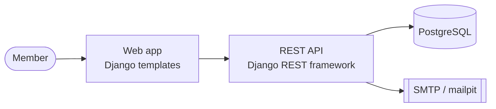

# C4 lite

Overview = level 2 (containers) only; level 1 in one sentence.

Then a table: container | technology | responsibility | requirements.
Name containers after what they do, not after the technology. Show external systems at the edge. Do not draw classes or deployment details here.
